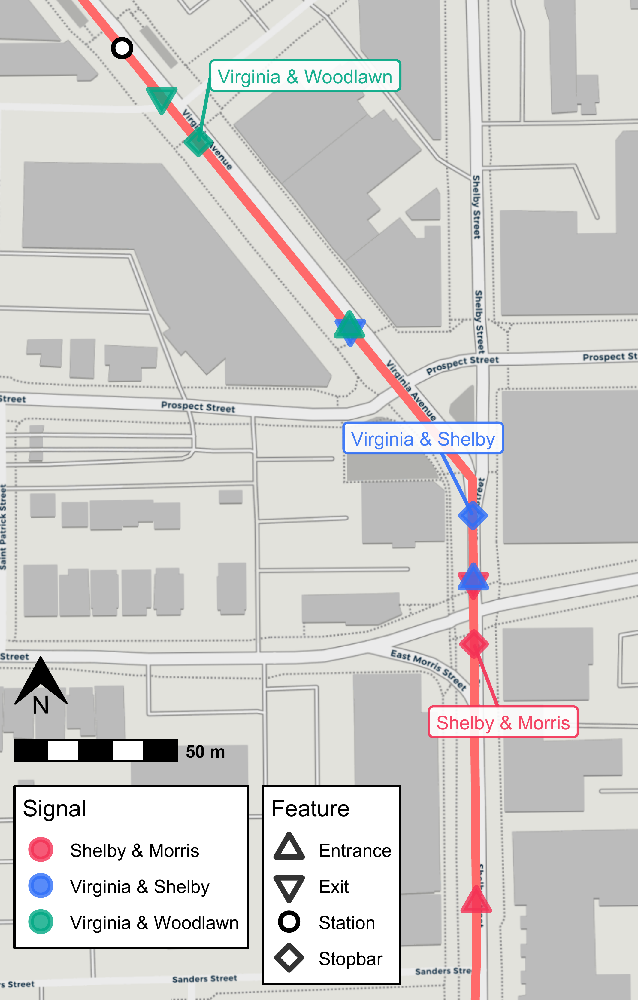
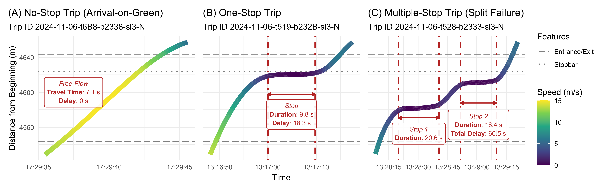
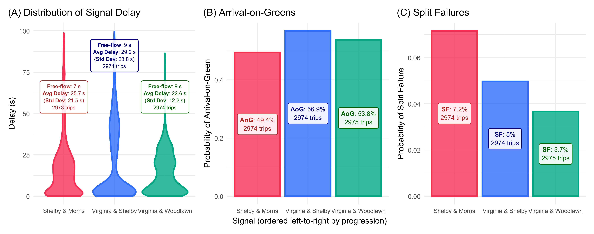

# Introduction

This vignette contains all code use to estimate and visualize the signal performance measures presented in [our paper](https://arxiv.org/abs/2608.31078). This demonstrates how `transittraj`'s `predict()` method for trajectory objects can easily estimate custom microscopic performance metrics.

This vignette is intended to complement our paper. Check out the [full paper](https://arxiv.org/abs/2608.31078) for a more thorough discussion of this methodology.

# Data

We've loaded the following data into our RStudio environment for this vignette:

  - `traj`: The reconstructed trajectory objects, as demonstrated in the data cleaning vignette.

  - `route_geom`: The Red Line's northbound alignment, as retrieved from IndyGo's GTFS via `transittraj::get_shape_geometry()`.

  - `stops`: The distance of each northbound Red Line stop along its alignment, as retrieved from IndyGo's GTFS via `transittraj::get_stop_distances()`.

  - `signals`: The distance of each north- and south-bound signal stopbar along the northbound route alignment. These were identified using OpenStreetMap data and Google Earth satellite imagery, then projected onto the route via `transittraj::project_onto_route()`.
  
We can begin by loading the packages we'll need:


``` r
# For analysis
library(transittraj)
library(tidyverse)

# For plotting
library(marquee)
library(patchwork)
library(ggspatial)
```


Next, we'll set some parameters for our visualizations:


``` r
# colors
my_r <- "#f43155"
my_b <- "#2f6ff8"
my_g <- "#00A884"

# marquee
marquee_label <- function(border = "firebrick") {
  
  lab <- classic_style(
    margin = trbl(0),
    padding = trbl(4),
    border = border,
    border_width = trbl(1),
    border_radius = 3,
    align = "center"
  )
  return(lab)
}

# Benchmark
bench_iter <- 20
```

Let's briefly explore our data. First, we can print a summary of our fit trajectory object `traj`. This tells us that, with the cleaning parameters used, we have 3100 valid trips. Trajectories were fit using VCHIP-ME interpolating splines.


``` r
summary(traj)
#> ------
#> AVL Group Trajectory Object
#> ------
#> Number of trips: 3100
#> Total distance range: 0 to 20499.99
#> Total time range: 1730433602 to 1735707538
#> ------
#> Trajectory function present: TRUE
#>    --> Trajectory interpolation method: monoH.FC
#>    --> Maximum derivative: 3
#>    --> Fit with speeds: TRUE
#> Inverse function present: TRUE
#>    --> Inverse function tolerance: 0.01
#> ------
```

Next, we'll demonstrate our spatial data. Each row of `stops` contains the stop's name, ID, and distance from the beginning terminal of the northbound Red Line:


``` r
head(stops)
#> # A tibble: 6 × 3
#>   stop_id stop_name       distance
#>   <chr>   <chr>              <dbl>
#> 1 70052   University            0 
#> 2 70051   Troy               1478.
#> 3 70049   Garfield Park      2245.
#> 4 70047   Raymond            3113.
#> 5 70045   Pleasant Run       3794.
#> 6 70043   Fountain Square    4846.
```

Similarly, `signals` contains each signal name and its distance from the northbound Red Line's beginning terminal. Each signal has two entries: one for the NB stopbar, and one for the SB.


``` r
head(signals)
#>              name    distance routes
#> 1 Shelby & Wesley    9.759449    90N
#> 2 Shelby & Wesley   39.076864    90S
#> 3 Shelby & Sumner  602.254030    90N
#> 4 Shelby & Sumner  645.204846    90S
#> 5   Shelby & Troy 1410.097237    90N
#> 6   Shelby & Troy 1449.998303    90S
```

# Spatial Setup

With our data loaded, we'll want to define entrance and exit points for each analysis signal. We'll begin by defining the corridor we're studying:


``` r
# Define filtering parameters
analysis_sigs <- c("Shelby & Morris",
                   "Virginia & Shelby",
                   "Virginia & Woodlawn")
analysis_stops <- c("Fountain Square")

# Filter
sigs_filt <- signals %>%
  filter(name %in% analysis_sigs)
sigs_NB <- sigs_filt %>%
  filter(routes == "90N") %>%
  select(-routes)
stops_filt <- stops %>%
  filter(stop_name %in% analysis_stops)
```

With this, we'll calculate the entrance and exit points. Exits are taken as the SB stopbar's location (except for Virginia & Woodlawn, where we move up the exit point slightly to avoid the Fountain Square bus stop). Next, entrances are taken as 80 meters upstream of Shelby & Morris, and at the preceding signal's exit point at Virginia & Shelby and Virginia & Woodlawn. We leave slight gaps -- less than 1 meter -- between the zones to prevent overlap.


``` r
# Opposing stopbar as exit point for all
sig_exits <- sigs_filt %>%
  filter(routes == "90S") %>%
  select(name, distance) %>%
  mutate(inout = "Exit",
         distance = if_else(condition = (name == "Virginia & Woodlawn"),
                            true = distance - 26,
                            false = distance))
# Entrance -- offset to match previous signal
sig_enters <- sigs_filt %>%
  filter(routes == "90N") %>%
  select(name, distance) %>%
  mutate(distance = case_when(
    name == "Shelby & Morris" ~ distance - 80,
    name == "Virginia & Shelby" ~ distance - 20,
    name == "Virginia & Woodlawn" ~ distance - 74
  ),
         inout = "Entrance")

# Combine
sig_bnds <- rbind(sig_enters, sig_exits) %>% arrange(distance)
sigs_sf <- sf::st_line_interpolate(line = route_geom %>% sf::st_as_sfc(),
                                    dist = sigs_NB$distance) %>%
  sf::st_sf() %>%
  mutate(name = sigs_NB$name,
         inout = "Stopbar")
sig_bnds_sf <- sf::st_line_interpolate(line = route_geom %>% sf::st_as_sfc(),
                                       dist = sig_bnds$distance) %>%
  sf::st_sf() %>%
  mutate(name = sig_bnds$name,
         inout = sig_bnds$inout)
stops_sf <- sf::st_line_interpolate(line = route_geom %>% sf::st_as_sfc(),
                                    dist = stops_filt$distance) %>%
  sf::st_sf() %>%
  mutate(name = stops_filt$stop_name)
```

We can now check out our bounding points:


``` r
knitr::kable(sig_bnds)
```


|name                | distance|inout    |
|:-------------------|--------:|:--------|
|Shelby & Morris     | 4543.542|Entrance |
|Shelby & Morris     | 4642.621|Exit     |
|Virginia & Shelby   | 4643.255|Entrance |
|Virginia & Shelby   | 4734.276|Exit     |
|Virginia & Woodlawn | 4734.695|Entrance |
|Virginia & Woodlawn | 4826.692|Exit     |


And we can visualize them along the route alignment:


``` r
# Bounding box
indy_crs <- 32616
bbox <- sf::st_bbox(sig_bnds_sf)
d_x <- 50 # m, x bbox expand
d_y <- 30 # m, y bbox expand
plot_bbox <- sf::st_bbox(c(bbox[1] - d_x,
                       bbox[2] - d_y,
                       bbox[3] + d_x,
                       bbox[4] + d_y),
                     crs = indy_crs)

# Map
sigs_map <- ggplot(data = rbind(sigs_sf, sig_bnds_sf)) +
  annotation_map_tile(type = "cartolight",
                      zoomin = 0, progress = "none") +
  geom_sf(data = route_geom, color = "indianred1",
          linewidth = 2) +
  annotation_north_arrow(which_north = "true",
                           location = "bl",
                           style = north_arrow_orienteering(fill = c("black", "black")),
                           height = unit(25, "pt"),
                           width = unit(25, "pt"),
                           pad_y = unit(140, "pt")) +
  annotation_scale(width_hint = 0.3,
                     location = "bl",
                     line_width = 1.5,
                     height = unit(10, "pt"),
                     text_face = "bold",
                   pad_y = unit(115, "pt"),
                   style = "bar") +
  geom_sf(aes(color = name, shape = inout, fill = name),
          size = 3.2, stroke = 1.8,
          alpha = 0.8) +
  geom_sf(data = stops_sf,
          aes(shape = "Station"),
          color = "black", fill = "white", stroke = 1.5, size = 3) +
  geom_spatial_label_repel(data = sigs_sf,
                           aes(label = name, color = name,
                               x = sf::st_coordinates(sigs_sf)[,1],
                               y = sf::st_coordinates(sigs_sf)[,2]),
                           crs = indy_crs,
                           size = 3.2, alpha = 0.9, box.padding = 2,
                           segment.size = 0.8, label.size = 0.5,
                           show.legend = FALSE, seed = 0) +
  scale_color_manual(name = "Signal",
                     values = c("Shelby & Morris" = my_r,
                                "Virginia & Shelby" = my_b,
                                "Virginia & Woodlawn" = my_g)) +
  scale_fill_manual(name = "Signal",
                     values = c("Shelby & Morris" = my_r,
                                "Virginia & Shelby" = my_b,
                                "Virginia & Woodlawn" = my_g)) +
  scale_shape_manual(name = "Feature",
                     values = c("Entrance" = 24,
                                "Exit" = 25,
                                "Stopbar" = 23,
                                "Station" = 21)) +
  theme_void() +
  coord_sf(xlim = c(plot_bbox["xmin"], plot_bbox["xmax"]),
           ylim = c(plot_bbox["ymin"], plot_bbox["ymax"]),
           crs = indy_crs, expand = FALSE) +
  theme(legend.position = c(0.325, 0.115),
        legend.background = element_rect(fill = "white",
                                         color = "black",
                                         linewidth = 0.5, linetype = "solid"),
        legend.box = "horizontal",
        legend.margin = margin(4, 4, 4, 4, unit = "pt"))
sigs_map
```




# Calculation of Performance Metrics

With our setup of spatial data complete, we can now use `transittraj` to estimate our signal performance measures. Here, we estimate three:

  - Signal delay, using `predict()`'s `new_distances` input.
  
  - Arrival-on-green, using `predict()`'s `distance_lims` and `timestep` inputs.
  
  - Split failures (SF), using the same `predict()` call as AoG.
  
As with the cleaning vignette, we wrap each `predict()` call in `bench::mark()` to record the processing time. We repeat each call 20 times and report the median processing time.

## Signal Delay

We'll begin with signal delay. For this, we'll simply pass our signal boundings `sig_bnds` to `predict()`. This will calculate the time each trip crossed each row in `sig_bnds`.


``` r
bm_crossings <- bench::mark(
  # transittraj
  predict(object = traj,
          new_distances = sig_bnds),
  # benchmark
  time_unit = "s", check = TRUE, iterations = bench_iter, min_time = Inf
)
#> Warning: Some expressions had a GC in every iteration; so filtering is disabled.
sig_crossings <- bm_crossings$result[[1]]
```

Each row of `sig_crossings` will represent each trip's crossing time through each exit and entrance point. If we pivot these rows to separate columns, we can subtract them to estimate each trip's travel time and delay through each signal.


``` r
# Pivot to calculate travel times
sig_tt <- sig_crossings %>%
  select(-distance) %>%
  pivot_wider(id_cols = c("trip_id_performed", "name"), names_from = inout,
              values_from = interp) %>%
  mutate(travel_time = Exit - Entrance) %>%
  filter(!is.na(travel_time))

# Summary stats -- including free-flow times by signal
sig_ff <- sig_tt %>%
  group_by(name) %>%
  summarize(min_tt = min(travel_time),
            max_tt = max(travel_time),
            tt_85th = quantile(travel_time, 0.85),
            free_flow = quantile(travel_time, 0.05),
            mean_tt = mean(travel_time),
            std_tt = sd(travel_time),
            n_trips = n())

# Delay
sig_delay <- sig_tt %>%
  left_join(y = (sig_ff %>% select(name, free_flow)),
            by = "name") %>%
  mutate(delay = pmax(0, travel_time - free_flow))
```

Let's see what this look like:


``` r
head(sig_delay)
#> # A tibble: 6 × 7
#>   trip_id_performed           name               Entrance        Exit travel_time free_flow delay
#>   <chr>                       <chr>                 <dbl>       <dbl>       <dbl>     <dbl> <dbl>
#> 1 2024-10-31-t19-b233E-sl3-N  Shelby & Morris 1730435778. 1730435810.       31.3       7.38 23.9 
#> 2 2024-10-31-t2D-b233A-sl3-N  Shelby & Morris 1730436767. 1730436780.       13.0       7.38  5.64
#> 3 2024-10-31-t5-b233D-sl3-N   Shelby & Morris 1730434557. 1730434574.       17.4       7.38  9.98
#> 4 2024-11-01-t19-b233E-sl3-N  Shelby & Morris 1730522390. 1730522439.       48.9       7.38 41.5 
#> 5 2024-11-01-t1FC-b232C-sl3-N Shelby & Morris 1730452895. 1730452988.       93.4       7.38 86.0 
#> 6 2024-11-01-t20B-b232D-sl3-N Shelby & Morris 1730453492. 1730453499.        7.04      7.38  0
```

Each trip's traversal through each signal corresponds to one row. Each traversal has a travel time, free-flow time, and estimated control delay. The free-flow time is dependent only upon the signal, and is the same for all trips through the same signal.

## Arrival-on-Green & Split Failures

For both of these metric's, we'll want to know how many stops each trip made. We will use the `predict()` method with the `distance_lims` and `timestep` inputs. In `distance_lims` we specify the entire length of the corridor (alternatively, you could run three separate `predict()` calls, with each specifying the bounds of one signal). In `timestep` we specify the temporal resolution of each trip's interpolated points between these distance bounds. Finally, using `deriv = c(0, 1)`, we ask `predict()` to return both the position and speed of each trip at each timepoint. The raw output includes separate rows for the speed and distance calculation at each timepoint; we'll pivot those to separate columns, such that each row corresponds to one timepoint of one trip.


``` r
timestep = 0.1 # seconds
step_bounds <- c(min(sig_bnds$distance), max(sig_bnds$distance))

# Predict: get distances & speeds
bm_interp <- bench::mark(
  # transittraj
  predict(object = traj,
          distance_lims = step_bounds,
          timestep = timestep,
          deriv = c(0, 1)),
  # benchmark
  time_unit = "s", check = TRUE, iterations = bench_iter, min_time = Inf
)
#> Warning: Some expressions had a GC in every iteration; so filtering is disabled.
trip_dists <- bm_interp$result[[1]]

# Pivot wider: give dist & speed separate columns
trip_dists_piv <- trip_dists %>%
  pivot_wider(id_cols = c("trip_id_performed", "event_timestamp"),
              names_from = "deriv", names_glue = "interp_{.name}",
              values_from = "interp") %>%
  rename(distance = interp_0,
         speed = interp_1)
```

Let's take a look at this output:


``` r
head(trip_dists_piv) %>%
  mutate(event_timestamp = sprintf(event_timestamp, fmt = "%.1f"),
         distance = sprintf(distance, fmt = "%.2f"),
         speed = sprintf(speed, fmt = "%.2f"))
#> # A tibble: 6 × 4
#>   trip_id_performed          event_timestamp distance speed
#>   <chr>                      <chr>           <chr>    <chr>
#> 1 2024-10-31-t19-b233E-sl3-N 1730435778.2    4543.53  11.87
#> 2 2024-10-31-t19-b233E-sl3-N 1730435778.3    4544.71  11.83
#> 3 2024-10-31-t19-b233E-sl3-N 1730435778.4    4545.89  11.79
#> 4 2024-10-31-t19-b233E-sl3-N 1730435778.5    4547.07  11.75
#> 5 2024-10-31-t19-b233E-sl3-N 1730435778.6    4548.24  11.71
#> 6 2024-10-31-t19-b233E-sl3-N 1730435778.7    4549.41  11.66
```

For each trip, we have a series of timestamps incrementing by 0.1 seconds, as we requested through `timestep`. Each timestep has a corresponding distance and speed estimate.

With this dataframe, we'll identify segments where each trip is stopped. We'll consider anything with a speed below 1.341 meters per second, roughly 3 mph, to be a stop, and use run line encoding (RLE) to identify successive points at or below this cutoff. Finally, we'll divide these points up by the signal bounding zones.


``` r
# Set up RLE
stop_cutoff <- 1.341 # m/s, roughly 3 mph
stopped_rle_fun <- function(is_stopped, trip_id_performed) {
  rle_obj <- rle(x = is_stopped)
  out_vec <- rep(x = seq_along(rle_obj$values), times = rle_obj$length)
  return(out_vec)
}

sig_bnds_join <- sig_bnds %>%
  pivot_wider(id_cols = "name", names_from = "inout", values_from = "distance")

# RLE
trip_stops <- trip_dists_piv %>%
  left_join(y = sig_bnds_join,
            join_by(distance >= Entrance, distance <= Exit)) %>%
  select(-c(Entrance, Exit)) %>%
  filter(!is.na(name)) %>%
  mutate(is_stopped = as.numeric(speed < stop_cutoff)) %>%
  arrange(trip_id_performed, event_timestamp) %>%
  group_by(trip_id_performed, name) %>%
  mutate(run_index = stopped_rle_fun(is_stopped = is_stopped),
         run_id = paste(trip_id_performed, name, run_index,
                        sep = "-")) %>%
  ungroup()
trip_events <- trip_stops %>%
  group_by(name, run_id) %>%
  summarize(trip_id_performed = first(trip_id_performed),
            is_stopped = max(is_stopped),
            time_begin = min(event_timestamp),
            time_end = max(event_timestamp),
            dist_begin = min(distance),
            dist_end = max(distance),
            dist_traveled = dist_end - dist_begin,
            time_elapsed = time_end - time_begin,
            .groups = "keep")
trip_sig_stops <- trip_events %>%
  group_by(name, trip_id_performed) %>%
  summarize(num_stops = sum(is_stopped),
            .groups = "keep") %>%
  mutate(makes_stop = as.numeric(num_stops > 0),
         makes_multiple_stops = as.numeric(num_stops > 1))
```

Let's look at output. After summarizing the RLE, we have the number of stops each trip makes:


``` r
head(trip_sig_stops)
#> # A tibble: 6 × 5
#> # Groups:   name, trip_id_performed [6]
#>   name            trip_id_performed           num_stops makes_stop makes_multiple_stops
#>   <chr>           <chr>                           <dbl>      <dbl>                <dbl>
#> 1 Shelby & Morris 2024-10-31-t19-b233E-sl3-N          1          1                    0
#> 2 Shelby & Morris 2024-10-31-t2D-b233A-sl3-N          0          0                    0
#> 3 Shelby & Morris 2024-10-31-t5-b233D-sl3-N           0          0                    0
#> 4 Shelby & Morris 2024-11-01-t19-b233E-sl3-N          1          1                    0
#> 5 Shelby & Morris 2024-11-01-t1FC-b232C-sl3-N         1          1                    0
#> 6 Shelby & Morris 2024-11-01-t20B-b232D-sl3-N         0          0                    0
```

This is all the data we need to easily estimate AoG and SF:


``` r
# Calculate AOG & SFs by time period
aog <- trip_sig_stops %>%
  group_by(name) %>%
  summarize(num_trips = n(),
            num_stops = sum(makes_stop),
            .groups = "keep") %>%
  mutate(num_thrus = num_trips - num_stops,
         est_AOG = num_thrus / num_trips)
split_failures <- trip_sig_stops %>%
  group_by(name) %>%
  summarize(num_trips = n(),
            num_mult_stops = sum(makes_multiple_stops),
            .groups = "keep") %>%
  mutate(sf = num_mult_stops / num_trips)
```

# Results

## Example Trajectories

We now have estimates for each signal's control delay, AoG, and SF over the study period, aggregated over all times of day and days of the week. Before exploring these results, we'll use them to visualize some example trajectories:


``` r
# - Setup -
plot_sig <- "Shelby & Morris"
sig_bounds <- sig_bnds %>%
  filter(name == "Shelby & Morris") %>%
  pull(distance)
plot_lims <- c(sig_bounds[1] - 15,
               sig_bounds[2] + 15)
stopbars_filt <- sigs_NB %>%
  filter(distance > plot_lims[1] &
           distance < plot_lims[2])

# - AoG (A) -
plot_trip1 <- "2024-11-06-t6B8-b2338-sl3-N"
plot_df1 <- predict(object = traj,
                    distance_lims = plot_lims,
                    timestep = timestep,
                    trip = plot_trip1,
                    deriv = c(0, 1)) %>%
  pivot_wider(id_cols = c("trip_id_performed", "event_timestamp"),
              values_from = "interp", names_from = deriv) %>%
  rename(distance = `0`,
         speed = `1`) %>%
  mutate(event_timestamp = as.POSIXct(event_timestamp, tz = "America/New_York"))
lab_df1 <- data.frame(x = quantile(plot_df1$event_timestamp, 0.20),
                     y = 4600,
                     trip_id_performed = plot_trip1,
                     name = plot_sig) %>%
  left_join(y = (sig_delay %>% select(trip_id_performed, name, travel_time, delay)),
            by = c("trip_id_performed", "name")) %>%
  mutate(travel_time = round(travel_time, 1),
         delay = round(delay, 1),
         lab = paste("*Free-Flow*  \n",
                     "**Travel Time**: ", travel_time, " s  \n",
                     "**Delay**: ", delay, " s",
                     sep = ""))

aog_plot <- ggplot() +
  geom_hline(aes(yintercept = sig_bounds, linetype = "Entrance/Exit"),
             color = "grey50", linewidth = 0.6) +
  geom_hline(data = stopbars_filt,
             aes(yintercept = distance, linetype = "Stopbar"),
             linewidth = 0.8, color = "grey50") +
  geom_line(data = plot_df1,
            aes(x = event_timestamp, y = distance, color = speed),
            linewidth = 3) +
  geom_marquee(data = lab_df1,
               aes(x = x, y = y, label = lab),
               hjust = 0.5, size = 3, color = "firebrick", fill = "#FFFFFFE6",
               style = marquee_label("firebrick")) +
  scale_linetype_manual(name = "Features",
                        values = c("Entrance/Exit" = "longdash",
                                   "Stopbar" = "dotted")) +
  scale_color_viridis_c(name = "Speed (m/s)",
                        limits = c(0, 15)) +
  scale_x_datetime(date_labels = "%H:%M:%S") +
  scale_y_continuous(limits = plot_lims) +
  theme_minimal() +
  labs(x = "Time",
       y = "Distance from Beginning (m)",
       title = "(A) No-Stop Trip (Arrival-on-Green)",
       subtitle = paste("Trip ID ", plot_trip1,
                        sep = "")) +
  theme(plot.title.position = "plot")

# - One Stop (B) -
plot_trip2 <- "2024-11-06-t519-b232B-sl3-N"
plot_df2 <- predict(object = traj,
                    distance_lims = plot_lims,
                    timestep = timestep,
                    trip = plot_trip2,
                    deriv = c(0, 1)) %>%
  pivot_wider(id_cols = c("trip_id_performed", "event_timestamp"),
              values_from = "interp", names_from = deriv) %>%
  rename(distance = `0`,
         speed = `1`) %>%
  mutate(event_timestamp = as.POSIXct(event_timestamp, tz = "America/New_York"))
stop_df2 <- trip_events %>%
  ungroup() %>%
  filter((trip_id_performed == plot_trip2) &
           (is_stopped == 1) &
           (name == plot_sig)) %>%
  select(trip_id_performed, name, time_begin, time_end, time_elapsed) %>%
  left_join(y = sig_delay %>% select(trip_id_performed, name, delay, travel_time),
            by = c("trip_id_performed", "name")) %>%
  mutate(time_elapsed = round(time_elapsed, 1),
         delay = round(delay, 1),
         travel_time = round(travel_time, 1),
         lab = paste("*Stop*  \n",
                     "**Duration**: ", time_elapsed, " s  \n",
                     "**Delay**: ", delay, " s",
                     sep = ""),
         x = (time_begin + time_end) / 2,
         y = sig_bounds[2] - 60)

del_plot <- ggplot() +
  geom_hline(aes(yintercept = sig_bounds, linetype = "Entrance/Exit"),
             color = "grey50", linewidth = 0.6) +
  geom_hline(data = stopbars_filt,
             aes(yintercept = distance, linetype = "Stopbar"),
             linewidth = 0.8, color = "grey50") +
  geom_vline(data = stop_df2,
             aes(xintercept = time_begin),
             color = "firebrick", linewidth = 1, linetype = "dotdash") +
  geom_vline(data = stop_df2,
             aes(xintercept = time_end),
             color = "firebrick", linewidth = 1, linetype = "dotdash") +
  geom_line(data = plot_df2,
            aes(x = event_timestamp, y = distance, color = speed),
            linewidth = 3) +
  geom_segment(data = stop_df2,
               aes(x = time_begin, xend = time_end,
                   y = y + 15, yend = y + 15),
               arrow = arrow(ends = "both", type = "closed", length = unit(0.025, units = "npc")),
               color = "firebrick", linetype = "solid", linewidth = 0.7) +
  geom_marquee(data = stop_df2,
               aes(x = x, y = y - 8, label = lab),
               hjust = 0.5, size = 3, color = "firebrick", fill = "#FFFFFFE6",
               style = marquee_label("firebrick")) +
  scale_linetype_manual(name = "Features",
                        values = c("Entrance/Exit" = "longdash",
                                   "Stopbar" = "dotted")) +
  scale_color_viridis_c(name = "Speed (m/s)",
                        limits = c(0, 15)) +
  scale_x_datetime(date_labels = "%H:%M:%S") +
  scale_y_continuous(limits = plot_lims) +
  theme_minimal() +
  labs(x = "Time",
       y = "Distance from Beginning (m)",
       title = "(B) One-Stop Trip",
       subtitle = paste("Trip ID ", plot_trip2,
                        sep = "")) +
  theme(plot.title.position = "plot")

# - SF (C) -
plot_trip3 <- "2024-11-06-t528-b2333-sl3-N"
plot_df3 <- predict(object = traj,
                    distance_lims = plot_lims,
                    timestep = timestep,
                    trip = plot_trip3,
                    deriv = c(0, 1)) %>%
  pivot_wider(id_cols = c("trip_id_performed", "event_timestamp"),
              values_from = "interp", names_from = deriv) %>%
  rename(distance = `0`,
         speed = `1`) %>%
  mutate(event_timestamp = as.POSIXct(event_timestamp, tz = "America/New_York"))
stop_df3 <- trip_events %>%
  ungroup() %>%
  filter((trip_id_performed == plot_trip3) &
           (is_stopped == 1) &
           (name == plot_sig)) %>%
  select(trip_id_performed, name, time_begin, time_end, time_elapsed) %>%
  left_join(y = sig_delay %>% select(trip_id_performed, name, delay),
            by = c("trip_id_performed", "name")) %>%
  mutate(time_elapsed = round(time_elapsed, 1),
         delay = round(delay, 1),
         lab = case_when(
           row_number() == 1 ~ paste("*Stop ", row_number(), "*  \n",
                                     "**Duration**: ", time_elapsed, " s",
                                     sep = ""),
           row_number() == 2 ~ paste("*Stop ", row_number(), "*  \n",
                                     "**Duration**: ", time_elapsed, " s  \n",
                                     "**Total Delay**: ", delay, " s",
                                     sep = "")
         ),
         x = (time_begin + time_end) / 2,
         y = c(sig_bounds[2] - 82, sig_bounds[2] - 65))

sf_plot <- ggplot() +
  geom_hline(aes(yintercept = sig_bounds, linetype = "Entrance/Exit"),
             color = "grey50", linewidth = 0.6) +
  geom_vline(data = stop_df3,
             aes(xintercept = time_begin),
             color = "firebrick", linewidth = 1, linetype = "dotdash") +
  geom_vline(data = stop_df3,
             aes(xintercept = time_end),
             color = "firebrick", linewidth = 1, linetype = "dotdash") +
  geom_hline(data = stopbars_filt,
             aes(yintercept = distance, linetype = "Stopbar"),
             linewidth = 0.8, color = "grey50") +
  geom_line(data = plot_df3,
            aes(x = event_timestamp, y = distance, color = speed),
            linewidth = 3) +
  geom_segment(data = stop_df3,
               aes(x = time_begin, xend = time_end, y = y + 10, yend = y + 10),
               arrow = arrow(ends = "both", type = "closed", length = unit(0.025, units = "npc")),
               color = "firebrick", linetype = "solid", linewidth = 0.7) +
  geom_marquee(data = stop_df3,
               aes(x = x, y = c(stop_df3$y[1] - 8, stop_df3$y[1] + 2), label = lab),
               hjust = 0.5, size = 3, color = "firebrick", fill = "#FFFFFFE6",
               style = marquee_label("firebrick")) +
  scale_linetype_manual(name = "Features",
                        values = c("Entrance/Exit" = "longdash",
                                   "Stopbar" = "dotted")) +
  scale_color_viridis_c(name = "Speed (m/s)",
                        limits = c(0, 15)) +
  scale_x_datetime(date_labels = "%H:%M:%S") +
  scale_y_continuous(limits = plot_lims) +
  theme_minimal() +
  labs(x = "Time",
       y = "Distance from Beginning (m)",
       title = "(C) Multiple-Stop Trip (Split Failure)",
       subtitle = paste("Trip ID ", plot_trip3,
                        sep = "")) +
  theme(plot.title.position = "plot")

# - Combine -
combo_plot <- aog_plot + del_plot + sf_plot +
  plot_layout(nrow = 1, ncol = 3,
              axis_titles = "collect", guides = "collect", axes = "collect")
combo_plot
```




Another way to visualize these is through animations. For non-technical audiences, these give a better idea of how these different conditions may effect passenger experience. `transittraj` supports two: animated maps and animated lines. For either, we can begin by setting our formatting parameters. See `help(plot_animated_map)` for a more thorough discussion on how this formatting works.


``` r
anim_df <- rbind(
  plot_df1 %>%
    mutate(Type = "No-Stop"),
  plot_df2 %>%
    mutate(Type = "One-Stop"),
  plot_df3 %>%
    mutate(Type = "Multiple-Stop")
)

# All features to plot
plot_features <- rbind(
  sig_bnds %>%
    filter(name %in% plot_sig) %>%
    select(distance) %>%
    mutate(Feature = "Entrance/Exit"),
  sigs_NB %>%
    filter(name %in% plot_sig) %>%
    select(distance) %>%
    mutate(Feature = "Stopbar")
)

# Trips tp plot
plot_trips <- c(plot_trip1, # No stop
                plot_trip2, # One stop
                plot_trip3) # SF

# Formatting
feat_format <- plot_features %>%
  mutate(shape = c(4, 4, 20)) %>%
  select(Feature, shape) %>%
  distinct(Feature, shape)
veh_format <- data.frame(Type = c("No-Stop",
                                  "One-Stop",
                                  "Multiple-Stop"),
                         shape = c(21, 24, 25),
                         outline = c(my_r, my_b, my_g)
)
```

Next, we'll call `plot_animated_map()` to generate our animation object. Before rendering the vignette, we've uploaded the output video to YouTube and embedded it below.


``` r
# Base anim
map_anim <- plot_animated_map(
  # Traj data
  distance_df = anim_df,
  center_vehicles = TRUE,
  # Spatial data
  shape_geometry = route_geom, distance_lims = plot_lims, bbox_expand = 20,
  background = "osm",
  # Route formatting
  route_color = "red4", route_width = 2.7,
  # Vehicle formatting
  veh_shape = veh_format, veh_outline = veh_format,
  veh_stroke = 2.5, veh_alpha = 0.9,
  # Feature formatting
  feature_distances = plot_features,
  feature_outline = "grey50", feature_shape = feat_format,
  feature_stroke = 2, feature_size = 3
)

# Extra Formatting
map_anim <- map_anim +
  labs(title = "Example Trajectories")
map_anim
```

<iframe src="https://www.youtube.com/embed/https://www.youtube.com/watch?v=hCGx4Ki3GRM" width="533" height="300" frameborder="0" allowfullscreen="" data-external="1"></iframe>

Finally, we'll generate an animated line using `plot_animated_line()`. We can use the same formatting parameters defined above.


``` r
# Base anim
line_anim <- plot_animated_line(
  # Traj data
  distance_df = anim_df,
  center_vehicles = TRUE,
  # Spatial data
  distance_lims = plot_lims,
  # Route formatting
  route_color = "red4", route_width = 2.7,
  # Vehicle formatting
  veh_shape = veh_format, veh_outline = veh_format,
  veh_stroke = 2.5, veh_alpha = 0.9,
  # Feature formatting
  feature_distances = plot_features,
  feature_outline = "grey50", feature_shape = feat_format,
  feature_stroke = 2, feature_size = 3
)

# Extra Formatting
line_anim <- line_anim +
  labs(title = "Example Trajectories",
       y = "Distance (m)")
line_anim
```

<iframe src="https://www.youtube.com/embed/https://www.youtube.com/watch?v=60AkEtYd9O0" width="533" height="300" frameborder="0" allowfullscreen="" data-external="1"></iframe>

## Performance Metrics

Next we'll generate some plots visualizing the metrics aggregated by signal. We'll generate violin plots to show the distribution of signal delays, and column charts to visualize the portion of AoG and SF:


``` r
# - Delay (A) -
lab_df1 <- sig_ff %>%
  mutate(mean_tt = round(mean_tt, 1),
         std_tt = round(std_tt, 1),
         free_flow = round(free_flow),
         lab = paste("**Free-flow**: ", free_flow,
                     " s  \n**Avg Delay**: ", mean_tt,
                     " s  \n(**Std Dev**: ", std_tt, 
                     " s)  \n", n_trips, " trips",
                     sep = ""),
         y = c(60, 85, 60),
         lab_color = case_when(
           name == "Shelby & Morris" ~ "firebrick",
           name == "Virginia & Shelby" ~ "navy",
           name == "Virginia & Woodlawn" ~ "darkgreen"
         ))

delay_violins <- ggplot(data = sig_delay) +
  geom_violin(aes(x = name, y = delay,
                  color = name, fill = name),
              show.legend = FALSE, alpha = 0.8, linewidth = 1) +
  scale_fill_manual(values = c("Shelby & Morris" = my_r,
                              "Virginia & Shelby" = my_b,
                              "Virginia & Woodlawn" = my_g)) +
  scale_color_manual(values = c("Shelby & Morris" = my_r,
                              "Virginia & Shelby" = my_b,
                              "Virginia & Woodlawn" = my_g)) +
  ggnewscale::new_scale_color() +
  geom_marquee(data = lab_df1,
               aes(x = name, y = y, label = lab, color = name,
                   style = marquee_label(lab_color)),
               hjust = 0.5, size = 2.5, fill = "#FFFFFFE6",
               show.legend = FALSE) +
  scale_color_manual(values = c("Shelby & Morris" = "firebrick",
                              "Virginia & Shelby" = "navy",
                              "Virginia & Woodlawn" = "darkgreen")) +
  theme_minimal() +
  labs(x = "Signal (ordered left-to-right by progression)",
       y = "Delay (s)",
       title = "(A) Distribution of Signal Delay") +
  ylim(c(0, 100)) +
  theme(plot.title.position = "plot",
        axis.text.x = element_text(size = 8))

# - AoG (B) -
lab_df2 <- aog %>%
  mutate(y = est_AOG / 2,
         est_AOG = round(100 * est_AOG, 1),
         lab = paste("**AoG**: ", est_AOG,
                     "%  \n", num_trips, " trips",
                     sep = ""),
         lab_color = case_when(
           name == "Shelby & Morris" ~ "firebrick",
           name == "Virginia & Shelby" ~ "navy",
           name == "Virginia & Woodlawn" ~ "darkgreen"
         ))
aog_bar <- ggplot() +
  geom_col(data = aog,
           aes(x = name, y = est_AOG,
               color = name, fill = name),
           alpha = 0.8, linewidth = 1,
           show.legend = FALSE) +
  scale_fill_manual(values = c("Shelby & Morris" = my_r,
                              "Virginia & Shelby" = my_b,
                              "Virginia & Woodlawn" = my_g)) +
  scale_color_manual(values = c("Shelby & Morris" = my_r,
                              "Virginia & Shelby" = my_b,
                              "Virginia & Woodlawn" = my_g)) +
  ggnewscale::new_scale_color() +
  geom_marquee(data = lab_df2,
               aes(x = name, y = y, label = lab, color = name,
                   style = marquee_label(lab_color)),
               hjust = 0.5, size = 3, fill = "#FFFFFFE6",
               show.legend = FALSE) +
  scale_color_manual(values = c("Shelby & Morris" = "firebrick",
                              "Virginia & Shelby" = "navy",
                              "Virginia & Woodlawn" = "darkgreen")) +
  theme_minimal() +
  labs(x = "Signal (ordered left-to-right by progression)",
       y = "Probability of Arrival-on-Green",
       title = "(B) Arrival-on-Greens") +
  theme(plot.title.position = "plot",
        axis.text.x = element_text(size = 8))

# - SF (C) -
lab_df3 <- split_failures %>%
  mutate(y = sf / 2,
         sf = round(100 * sf, 1),
         lab = paste("**SF**: ", sf,
                     "%  \n", num_trips, " trips",
                     sep = ""),
         lab_color = case_when(
           name == "Shelby & Morris" ~ "firebrick",
           name == "Virginia & Shelby" ~ "navy",
           name == "Virginia & Woodlawn" ~ "darkgreen"
         ))
sf_bar <- ggplot() +
  geom_col(data = split_failures,
           aes(x = name, y = sf,
               color = name, fill = name),
           alpha = 0.8, linewidth = 1,
           show.legend = FALSE) +
  scale_fill_manual(values = c("Shelby & Morris" = my_r,
                              "Virginia & Shelby" = my_b,
                              "Virginia & Woodlawn" = my_g)) +
  scale_color_manual(values = c("Shelby & Morris" = my_r,
                              "Virginia & Shelby" = my_b,
                              "Virginia & Woodlawn" = my_g)) +
  ggnewscale::new_scale_color() +
  geom_marquee(data = lab_df3,
               aes(x = name, y = y, label = lab, color = name,
                   style = marquee_label(lab_color)),
               hjust = 0.5, size = 3, fill = "#FFFFFFE6",
               show.legend = FALSE) +
  scale_color_manual(values = c("Shelby & Morris" = "firebrick",
                              "Virginia & Shelby" = "navy",
                              "Virginia & Woodlawn" = "darkgreen")) +
  theme_minimal() +
  labs(x = "Signal (ordered left-to-right by progression)",
       y = "Probability of Split Failure",
       title = "(C) Split Failures") +
  theme(plot.title.position = "plot",
        axis.text.x = element_text(size = 8))

# - Combine -
combo_plot <- delay_violins + aog_bar + sf_bar +
  plot_layout(ncol = 3, nrow = 1,
              axis_titles = "collect")
combo_plot
```




## Performance

The final relevant component is the computation time required for each of the two `predict()` calls. These are stored in the benchmarking objects:


``` r
# Time for signal delay interp (seconds)
print(bm_crossings)
#> # A tibble: 1 × 13
#>   expression    min median `itr/sec` mem_alloc `gc/sec` n_itr  n_gc total_time result memory     time       gc      
#>   <bch:expr>  <dbl>  <dbl>     <dbl> <bch:byt>    <dbl> <int> <dbl>      <dbl> <list> <list>     <list>     <list>  
#> 1 predict(ob…  3.33   3.38     0.293    5.96MB     1.38    20    94       68.3 <df>   <Rprofmem> <bench_tm> <tibble>

# Time for AoG/SF stepped interp (seconds)
print(bm_interp)
#> # A tibble: 1 × 13
#>   expression           min median `itr/sec` mem_alloc `gc/sec` n_itr  n_gc total_time result   memory     time      
#>   <bch:expr>         <dbl>  <dbl>     <dbl> <bch:byt>    <dbl> <int> <dbl>      <dbl> <list>   <list>     <list>    
#> 1 predict(object = …  71.7   72.4    0.0137     636MB    0.958    20  1400      1461. <tibble> <Rprofmem> <bench_tm>
#> # ℹ 1 more variable: gc <list>
```


